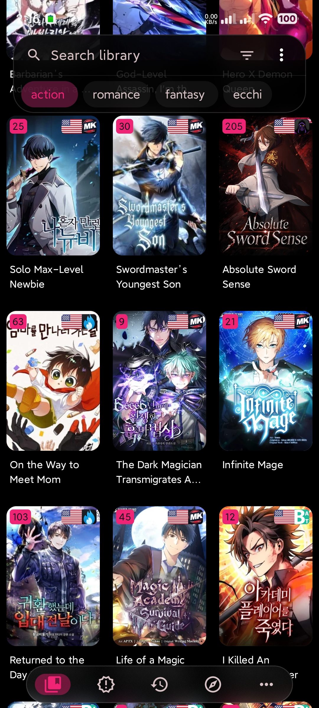
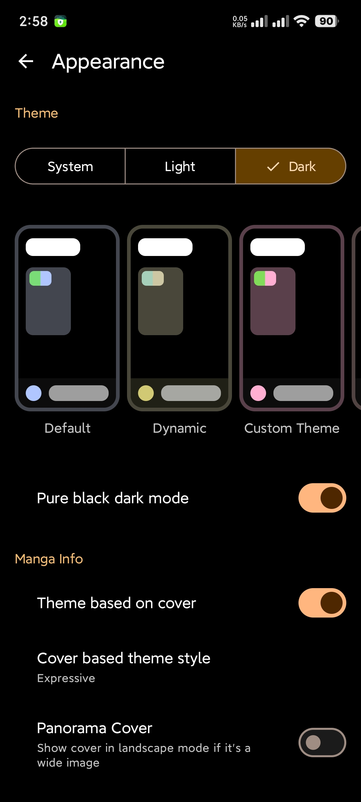
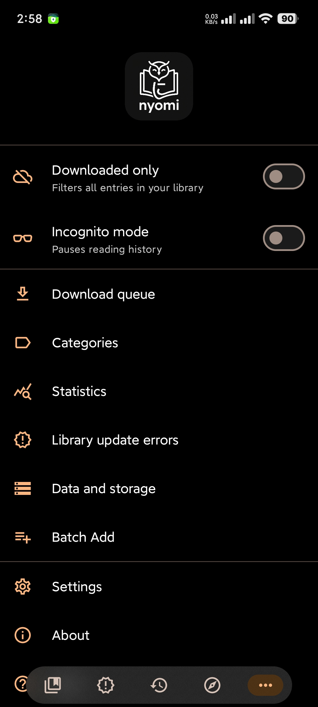
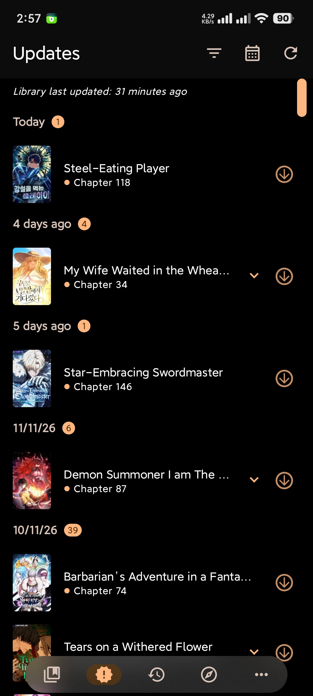
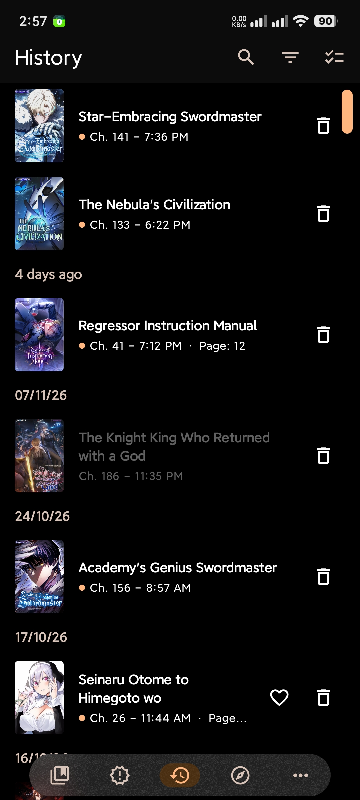

  
  <h1>Nyomi</h1>
  
A standalone fork of <a href="https://github.com/komikku-app/komikku">Komikku</a> (<code>app.nyomi</code>) focused on refined navigation ergonomics, AMOLED theming, and UI polish.

## Highlights & Changes from Upstream (`v1.14.1`)

- **Standalone Package (`app.nyomi`):** Installs independently alongside Komikku without package or data conflicts.
- **Floating Dock Clearance:** Refined bottom padding and scroll clearance across Library, Updates, History, and More views so the floating navigation dock never crowds content.
- **Search Pill & Category Chips:** Tuned the search pill bar and horizontal category filter chips in the Library view.
- **Appearance & AMOLED Polish:** Supports System/Light/Dark modes, theme presets (Default, Dynamic, Custom Theme), Pure black dark mode, and cover-based theming.

## Screenshots

  
  
  
  
  

## Download

Download the latest signed `arm64-v8a` release APK from the [Releases](https://github.com/robbisardar39-jpg/Nyomi/releases) page (for example, [`v1.14.2`](https://github.com/robbisardar39-jpg/Nyomi/releases/tag/v1.14.2)).

## License

Licensed under the Apache License, Version 2.0. See [LICENSE](LICENSE) for details.
